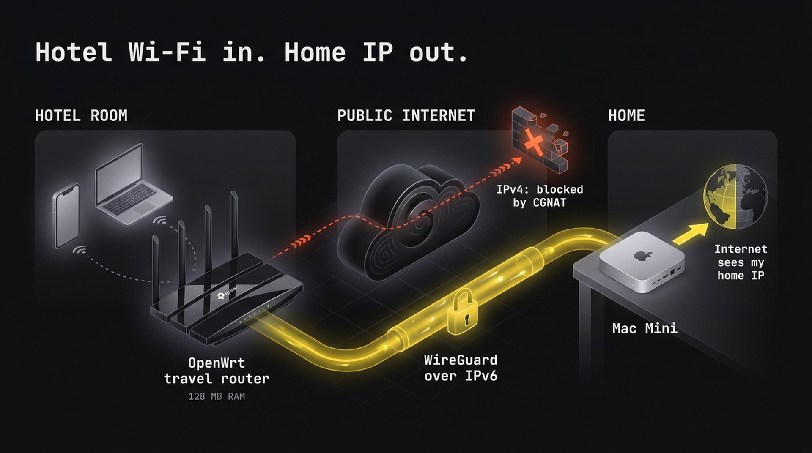
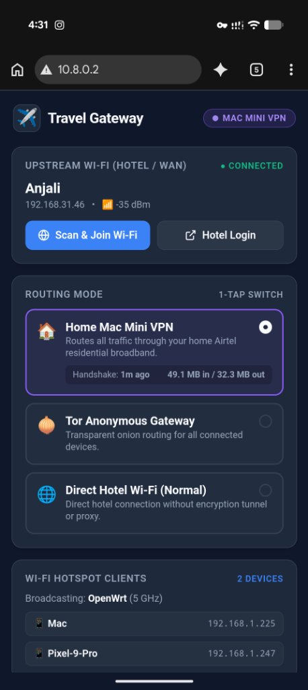
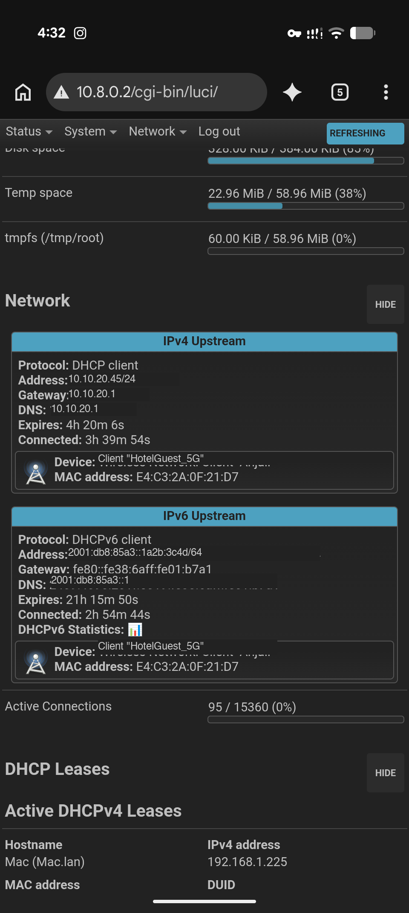
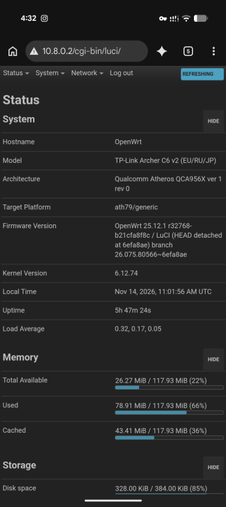

# ✈️ OpenWrt Travel Gateway

> **Turn any old, constrained router into a dedicated, travel-ready security gateway with 1-tap residential VPN tunneling, automated captive portal interception, and mobile-first Wi-Fi joining.**

[](https://openwrt.org/)
[](https://www.wireguard.com/)
[](router/www/)
[](LICENSE)

<p align="center">
  
</p>

---

## 📌 Why

Corporate SSO and security tools flag logins from hotel Wi-Fi, commercial VPNs, and cloud IP ranges. They expect traffic from your home ISP. This project puts one private hotspot in your bag and sends every device's traffic home first:

```
Phone / laptop ──Wi-Fi──▶ Travel router ──WireGuard over IPv6──▶ Home Mac Mini ──▶ Internet
                          (joins hotel Wi-Fi)                     (home IP address)
```

IPv6 avoids home ISP CGNAT, so you don't need a VPS, Cloudflare Tunnel, or port forwarding on IPv4.

### ✨ Features
- **Home IP everywhere:** every device on the hotspot uses your home connection.
- **1-tap modes:** Home VPN (WireGuard), Tor, or direct hotel Wi-Fi.
- **Wi-Fi scanner:** pick the hotel network from your phone, with signal bars.
- **Captive-portal detection:** Android and iOS show "Sign in to network," which opens the portal.
- **5.6 KB UI:** one HTML file, gzipped, with a 2 KB shell CGI backend.
- **Fits tiny routers:** tested on an Archer C6 v2 (128 MB RAM, 384 KiB overlay). WireGuard runs in the kernel and is loaded into RAM on demand.

> **Requirement:** the tunnel runs over IPv6, so both your home connection and the upstream network need IPv6. On IPv4-only networks, use direct or Tor mode.

| 1-tap portal | Dual-stack upstream | 128 MB RAM, 384 KiB overlay |
|:---:|:---:|:---:|
|  |  |  |

---

## 📖 The Story

How it was built, including an old MacBook with an Ethernet port, a Cloudflare Tunnel that ran out of memory, and the switch to IPv6. Read the **[blog post](https://kanakjr.in/blog/openwrt-travel-gateway)** or **[STORY.md](STORY.md)**.

---

## 🚀 Quick Start Guide

### 1. Home Server Setup (Mac Mini / Linux)
1. Install WireGuard tools:
   ```bash
   # On macOS via Homebrew:
   brew install wireguard-tools bash
   ```
2. Configure `/opt/homebrew/etc/wireguard/wg0.conf` using the template in [`server/wg0.conf.example`](server/wg0.conf.example).
3. Start the server and enable auto-boot on macOS:
   ```bash
   sudo ./server/wireguard-manager.sh install-service
   ```

### 2. Router Setup (OpenWrt)
1. No WireGuard install step on flash is needed. `hotspot-mode` downloads `kmod-wireguard` and `wireguard-tools` into RAM (`/tmp`) with `apk` the first time VPN mode is switched on, which leaves room on routers with very little free flash. The router needs internet access (via the upstream Wi-Fi) for that first download after each boot.
2. Configure `/etc/wireguard/wg0.conf` on the router:
   ```ini
   [Interface]
   Address = 10.8.0.2/24
   PrivateKey = <ROUTER_CLIENT_PRIVATE_KEY>

   [Peer]
   PublicKey = <SERVER_PUBLIC_KEY>
   Endpoint = [<YOUR_HOME_IPV6_ENDPOINT>]:51820
   AllowedIPs = 0.0.0.0/0, ::/0
   PersistentKeepalive = 25
   ```
3. Deploy the portal and management scripts to your router:
   ```bash
   ./scripts/deploy-to-router.sh 192.168.1.1
   ```

### 3. Usage on the Road
1. Power on your travel router in your hotel room.
2. Connect your phone or laptop to your private hotspot Wi-Fi.
3. Open **`http://travel.lan`** (or **`http://10.8.0.2`**).
4. Tap **Scan & Join Wi-Fi**, select your hotel Wi-Fi, then tap **Home Mac Mini VPN**.
5. All your devices are now safely browsing through your home connection!

---

## 🔒 Security & Privacy Notice

- This repository contains **generic templates only**. Never commit private keys, ISP credentials, or home IP addresses.
- All configuration files in this repository use sanitized placeholders (`<SERVER_PUBLIC_KEY>`, `<HOTEL_WIFI_PASSWORD>`, etc.).
- Ensure your home router has UDP port `51820` opened/pinholed in its IPv6 firewall.

---

## 📄 License

This project is licensed under the MIT License. See [LICENSE](LICENSE) for details.
