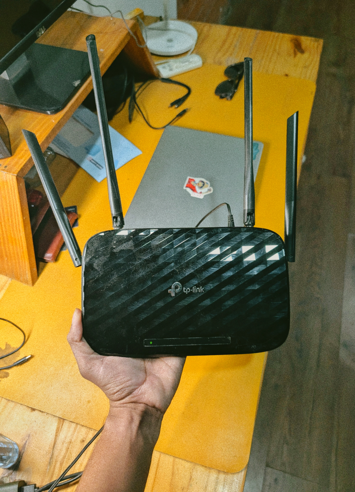

# ✈️ OpenWrt Travel Gateway

> **Turn any old, constrained router into a dedicated, travel-ready security gateway with 1-tap residential VPN tunneling, automated captive portal interception, and mobile-first Wi-Fi joining.**

[](https://openwrt.org/)
[](https://www.wireguard.com/)
[](router/www/)
[](LICENSE)

<p align="center">
  
</p>

---

## 📌 The Problem: Remote Work vs. Real World

When you travel as a software engineer or remote worker, you run into two constant friction points:

1. **Workplace Geo-Restrictions & Security Checks:** Many corporate systems flag sudden IP location changes or untrusted commercial VPN subnets (AWS/DigitalOcean/NordVPN). They expect your traffic to originate from your verified home residential ISP.
2. **Untrusted Hotel & Public Wi-Fi:** Connecting work laptops directly to hotel, airport, or coffee shop networks exposes them to MITM attacks, DNS spoofing, and restrictive network firewalls.
3. **Clunky Router Interfaces:** Connecting an OpenWrt router to hotel Wi-Fi usually means logging into LuCI on a cramped phone screen, clicking through multiple network tabs, and fiddling with interface bindings.

---

## 💡 The Solution: Pocket Residential Gateway

**OpenWrt Travel Gateway** repurposes any low-cost router (even with strict hardware limits like 128 MB RAM and under 100 KB free flash) into a dedicated travel companion:

```
[ Phone / Work Laptop ]
           │
           │ (Connects to private 5 GHz Wi-Fi Hotspot)
           ▼
[ OpenWrt Travel Router ] ── (2.4 GHz STA joins Hotel / Airport Wi-Fi)
           │
           │ Direct Kernel WireGuard Tunnel (`wireguard.ko`) over IPv6
           │ (Bypasses ISP CGNAT naturally with line-rate wire speed)
           ▼
[ Home Host / Mac Mini ] ── (Residential Fiber Broadband Connection)
           │
           ▼
  [ Public Internet ] ── (Sees your home residential IP everywhere!)
```

### ✨ Key Features
- **🏠 Residential IP Everywhere:** All client devices connected to your travel hotspot egress through your home residential broadband connection.
- **🔍 Mobile-First Wi-Fi Scanner:** 1-tap scan of nearby hotel networks with signal bars and instant connection prompt.
- **🔄 1-Tap Gateway Switcher:** Toggle instantly between:
  - 🏠 **Home Mac Mini VPN:** Direct WireGuard tunnel.
  - 🧅 **Tor Anonymous Gateway:** Transparent onion routing.
  - 🌐 **Direct Hotel WAN:** Standard repeater mode.
- **📱 RFC Captive Portal Detection:** When you arrive at a hotel without internet, Android and iOS automatically display the "Sign-in to network" notification, opening the portal directly in the system webview.
- **⚡ Zero-Dependency 5.6 KB UI:** Single-file HTML/CSS/JS gzipped to 5.6 KB. Loads in under 50 ms directly from RAM.
- **💻 Ultra-Constrained Hardware Ready:** Built and tested on real-world legacy hardware (TP-Link Archer C6 v2, Qualcomm Atheros QCA956X, 128 MB RAM, 384 KiB overlay flash). Operates seamlessly with ~0 MB userspace memory overhead.

<p align="center">
  
  <br>
  <em>Mobile portal running live at http://travel.lan for 1-tap gateway switching and nearby Wi-Fi joining.</em>
</p>

---

## 📖 The Story Behind This Project

For the complete narrative detailing how this project came to life—including the **old MacBook LAN port hack**, the **Cloudflare Tunnel OOM crash**, and the **IPv6 discovery**—read the full chronicle:

👉 **[Read the Full Story: From Discarded Router to Global Travel Gateway](STORY.md)**

---

## 🚀 Quick Start Guide

### 1. Home Server Setup (Mac Mini / Linux)
1. Install WireGuard tools:
   ```bash
   # On macOS via Homebrew:
   brew install wireguard-tools bash
   ```
2. Configure `/opt/homebrew/etc/wireguard/wg0.conf` using the template in [`server/wg0.conf.example`](server/wg0.conf.example).
3. Start the server and enable auto-boot on macOS:
   ```bash
   sudo ./server/wireguard-manager.sh install-service
   ```

### 2. Router Setup (OpenWrt)
1. Ensure WireGuard kernel modules are available:
   ```sh
   opkg update && opkg install kmod-wireguard wireguard-tools
   ```
2. Configure `/etc/wireguard/wg0.conf` on the router:
   ```ini
   [Interface]
   Address = 10.8.0.2/24
   PrivateKey = <ROUTER_CLIENT_PRIVATE_KEY>

   [Peer]
   PublicKey = <SERVER_PUBLIC_KEY>
   Endpoint = [<YOUR_HOME_IPV6_ENDPOINT>]:51820
   AllowedIPs = 0.0.0.0/0, ::/0
   PersistentKeepalive = 25
   ```
3. Deploy the portal and management scripts to your router:
   ```bash
   ./scripts/deploy-to-router.sh 192.168.1.1
   ```

### 3. Usage on the Road
1. Power on your travel router in your hotel room.
2. Connect your phone or laptop to your private hotspot Wi-Fi.
3. Open **`http://travel.lan`** (or **`http://10.8.0.2`**).
4. Tap **Scan & Join Wi-Fi** $\rightarrow$ select your hotel Wi-Fi $\rightarrow$ tap **Home Mac Mini VPN**.
5. All your devices are now safely browsing through your home connection!

---

## 🔒 Security & Privacy Notice

- This repository contains **generic templates only**. Never commit private keys, ISP credentials, or home IP addresses.
- All configuration files in this repository use sanitized placeholders (`<SERVER_PUBLIC_KEY>`, `<HOTEL_WIFI_PASSWORD>`, etc.).
- Ensure your home router has UDP port `51820` opened/pinholed in its IPv6 firewall.

---

## 📄 License

This project is licensed under the MIT License. See [LICENSE](LICENSE) for details.
