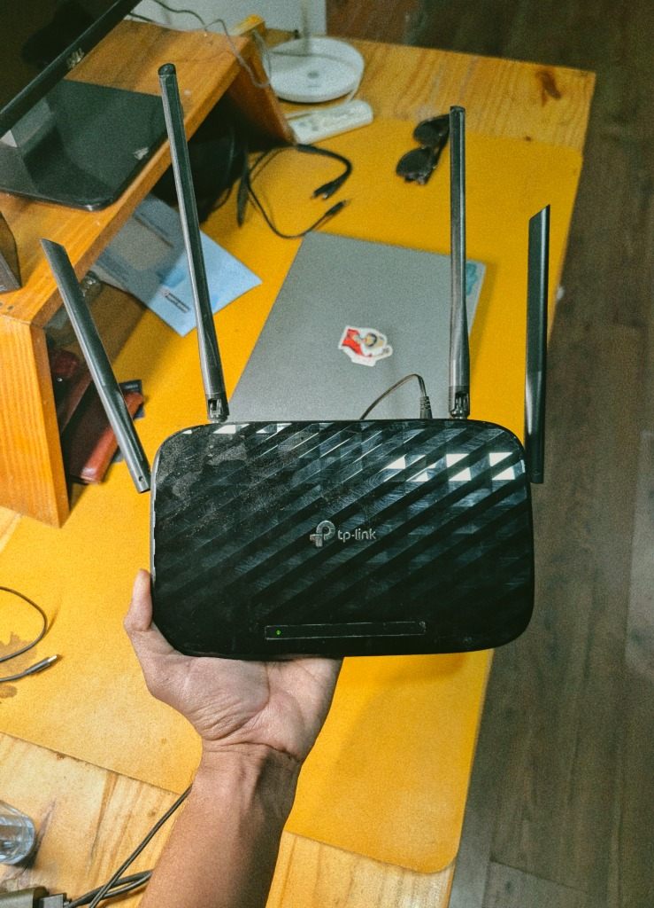
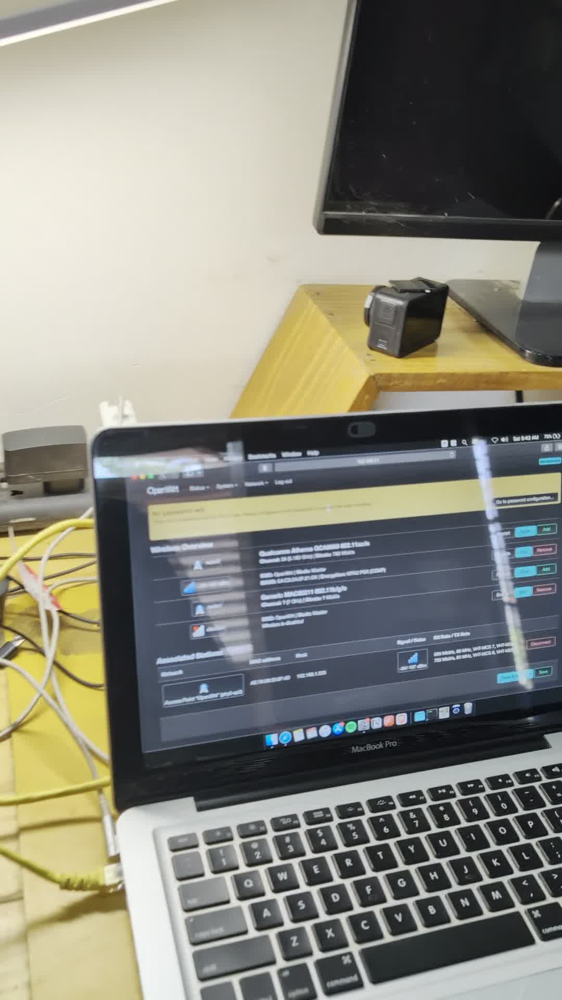
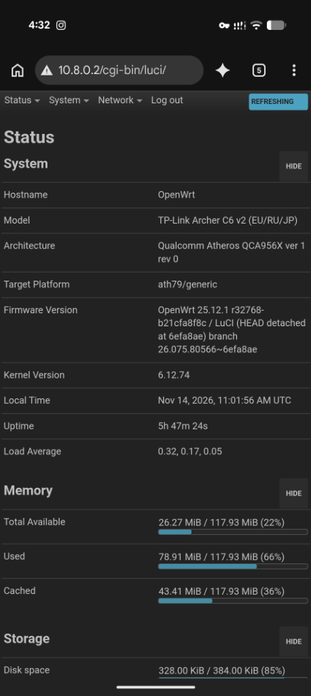
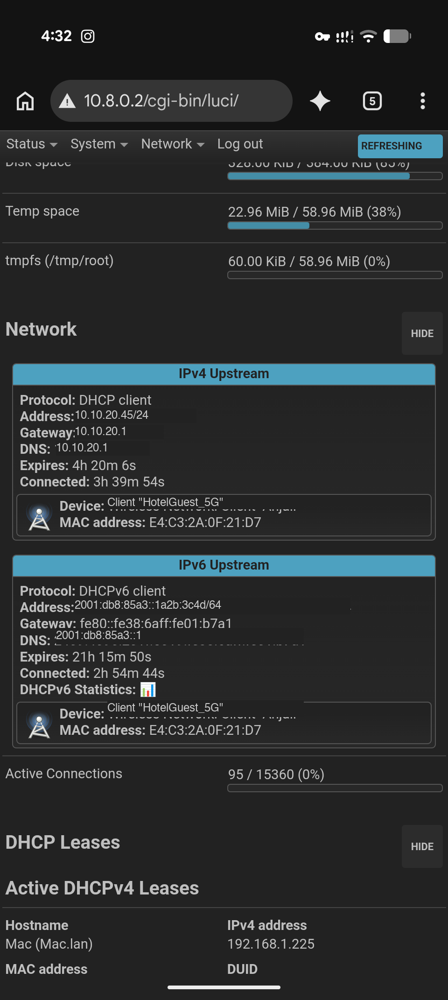
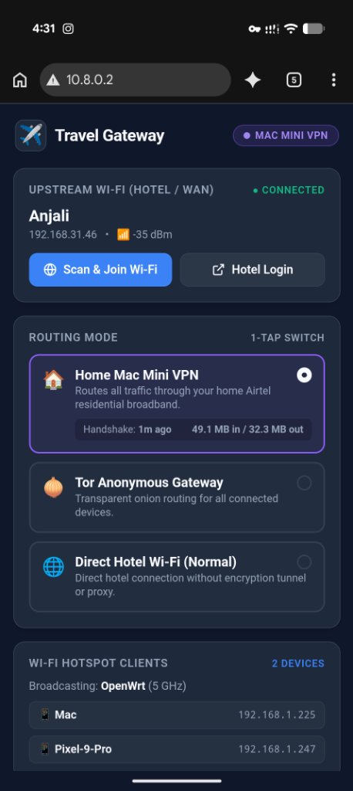

# 🛠️ The Accidental Travel Gateway

### *How an Old Discarded Router, a Legacy MacBook with an Ethernet Port, and an IPv6 Discovery Solved My Remote Work Dilemma*

*By Kanak • Technical Retrospective & Build Journey*

---

## ☕ Introduction: The Problem That Started in a Drawer

A few weeks ago, I upgraded my home broadband connection to high-speed fiber. With the new ISP came a shiny new mesh Wi-Fi system (TP-Link Deco). That left my previous router—a humble, slightly battered dual-band Wi-Fi router with an Atheros MIPS chip and a modest 128 MB of RAM—sitting in an electronics drawer, collecting dust.

Most people would toss it into an e-waste bin or stash it in the attic. But as a software engineer who travels frequently, I had a persistent itch that needed scratching:

> **The Remote Work Dilemma:**  
> When you travel for work or vacation, connecting directly to hotel, cafe, or airport Wi-Fi comes with real pain:
> 1. **Corporate Geo-Restrictions & VPN Flags:** Many modern workplaces enforce strict geo-fences or flag commercial VPN ranges (NordVPN, ExpressVPN, or cloud providers like AWS/DigitalOcean). They expect your traffic to originate from your verified home residential ISP.
> 2. **Untrusted Public Wi-Fi:** Public hotel networks are notorious for captive-portal tampering, snooping, and restrictive firewalls.
> 3. **The Multi-Device Hassle:** Setting up VPNs individually across a work laptop, personal laptop, phone, and tablet every time you change hotel rooms is frustrating.

I wanted a single, pocket-sized box. Whenever I arrive at a hotel anywhere in the world, I power it on. It joins the hotel Wi-Fi, creates a private 5 GHz hotspot for all my devices, and **transparently tunnels every byte of traffic back through my home Mac Mini**, making all my devices appear as if I were sitting at my desk at home.

The router in question was an old **TP-Link Archer C6 v2 (Qualcomm Atheros QCA956X)** with 128 MB RAM and an SPI flash overlay of just 384 KiB. The discarded router in my drawer was about to get a second life.

<p align="center">
  
  <br>
  <em>The repurposed TP-Link Archer C6 v2—resurrected from a desk drawer into a dedicated travel gateway.</em>
</p>

---

## 💻 Act I: The LAN Port Dilemma & The Old MacBook Hack

Every hacker project begins with an absurd hardware roadblock. Mine hit within five minutes.

To flash and configure the router with OpenWrt, I needed a wired Ethernet connection to `192.168.1.1`. 

I grabbed my daily driver: a sleek, modern MacBook Pro. It has gorgeous screens, screaming fast Apple Silicon, and... **zero physical RJ45 Ethernet ports**. And naturally, in true developer fashion, my USB-C to Ethernet dongle had vanished into the void.

```
[ Router (Factory Default / Unconfigured) ]
           │
           │ (Needs physical RJ45 Ethernet cable)
           ▼
[ Modern MacBook Pro ] ──> "Where is the LAN port?!" 🚫
```

I stood in my room staring at an Ethernet cable with nothing to plug it into.

Then I remembered: buried in my closet was an ancient, mid-2012 unibody MacBook. It was heavy, ran hot, and its battery had seen better days. But running my hand along its aluminum edge, there it was: **a glorious, native, physical RJ45 Gigabit Ethernet jack.**

```
[ Old Unibody MacBook ] ── (Built-in RJ45) ──> [ Discarded Router ]
           │
           │ (Bridged / SSH / TFTP bootstrap)
           ▼
   [ OpenWrt Installed! ]
```

I booted up the legacy MacBook, plugged the Ethernet cable directly into the router's LAN port, assigned a static IP, and within minutes, I was flashing the OpenWrt squashfs firmware over TFTP and SSH. That ancient laptop single-handedly rescued the project before it even began.

<p align="center">
  
  <br>
  <em>Figure: The legacy unibody MacBook with physical RJ45 Gigabit Ethernet port bootstrapping the TP-Link router alongside the modern MacBook.</em>
</p>

> 🎥 **Build Walkthrough Video:** The full dual-MacBook setup and flashing sequence is recorded in [`assets/build-setup-video.mp4`](assets/build-setup-video.mp4).

---

## 💥 Act II: The 128 MB RAM Wall & The Cloudflare OOM Crash

With OpenWrt installed, I faced the primary networking challenge:

**Home ISPs in India (like Airtel Broadband) place all residential IPv4 connections behind Carrier-Grade NAT (CGNAT).** 

Under CGNAT, your home router does not receive a public IPv4 address. You cannot open inbound ports, port forward, or host a traditional WireGuard server on IPv4 without an external relay.

My first thought was: **Cloudflare Tunnel (`cloudflared`) + Transparent Proxy (GOST / redsocks)**.

```
[ Phone / Laptop ] ➔ [ OpenWrt Router ] ➔ [ Cloudflare Tunnel (WSS) ] ➔ [ Mac Mini ] ➔ [ Internet ]
```

The theory looked brilliant on paper:
- Cloudflare tunnels establish an *outbound* persistent connection from the Mac Mini to Cloudflare's edge.
- No port forwarding or public IP needed on the home network.
- The router could intercept TCP connections and wrap them into HTTPS CONNECT tunnels over WebSockets.

### The Crashing Reality:
When I deployed this setup onto the OpenWrt router, two fatal flaws shattered the plan:

1. **Cloudflare Edge HTTP CONNECT Restriction:**  
   Cloudflare's public reverse proxy strictly rejects raw HTTP `CONNECT` verb requests with `curl: (56) CONNECT tunnel failed, response 400 Bad Request`.
2. **The Linux Kernel OOM Killer:**  
   To work around Cloudflare, I cross-compiled `gost` (a Go-based tunneling tool) for the router's MIPS architecture. The moment `gost` started its WebSocket listener, the Go runtime initialized its garbage collector and heap. On a constrained 128 MB RAM router, the Go process requested over **631 MB of virtual memory** and **15 MB RSS**.
   
   The Linux kernel immediately fired its emergency defense:
   ```
   [ 7778.024299] oom-kill: global_oom, task=gost, total-vm:631484kB, anon-rss:15096kB
   ```
   **The router froze, killed the process, and dropped all connections.**

To make matters worse, the router's flash overlay only had **~56 KB to 84 KB of free persistent disk space** (328 KiB out of 384 KiB used). Massive userspace binaries were completely out of the question.

<p align="center">
  
  <br>
  <em>Figure 1: LuCI system status on the TP-Link Archer C6 v2 showing 128 MB RAM and the razor-thin 384 KiB overlay flash space.</em>
</p>

---

## ⚡ Act III: The IPv6 Epiphany & Bypassing CGNAT Naturally

Sitting back at my desk, feeling defeated by the memory wall, I started questioning the fundamental premise:

*Why am I torturing a 128 MB router with heavy userspace proxies to dance around IPv4 CGNAT, when the modern internet has an entirely separate addressing system?*

I ran `ifconfig` on my home Mac Mini:
```
en0: inet 192.168.68.100 (Behind CGNAT)
     inet6 fe80::... (Link-local only)
```
No public IPv6. Why?

I checked the home master router: a TP-Link Deco M4 mesh system. By default, **IPv6 was turned off**.

I opened the TP-Link Deco mobile app and enabled IPv6. Because Airtel operates over PPPoE, I configured:
- **Connection Type:** PPPoE
- **Same session as IPv4 connection:** ON *(shares active PPPoE credentials)*
- **Prefix Delegation:** ON (Auto SLAAC)

Within 15 seconds, the Mac Mini renegotiated with the router. I ran `ifconfig en0`:
```
inet6 2401:xxxx:xxxx:xxxx::1000 prefixlen 64 dynamic
```
A globally routable, public IPv6 address straight from Airtel's fiber backbone! I tested external connectivity:
```bash
$ ping6 2001:4860:4860::8888
3 packets transmitted, 3 received, 0% packet loss, avg 12.0 ms
```

### The Architectural Breakthrough:
**IPv6 has no Carrier-Grade NAT.** Every device receives a globally routable public address.

Instead of running bloated userspace Go binaries, I could use **WireGuard directly in the Linux kernel (`wireguard.ko`)**:
- **Memory footprint:** Virtually **0 MB** in userspace (processed directly inside kernel network buffers).
- **Disk footprint:** Zero userspace daemon needed.
- **Speed:** Full wire-rate line speed with native ChaCha20-Poly1305 hardware instructions.

```
[ Travel Router ] ── (Direct UDP [2401:4900:...]:51820) ──> [ Home Mac Mini ] ──> [ Residential Airtel IP ]
```

I brought up the tunnel:
```
interface: wg0
  latest handshake: 14 seconds ago
  transfer: 49.15 MiB received, 32.34 MiB sent
```
**Zero OOM errors. Zero dropped packets. Pure line-rate residential internet.**

<p align="center">
  
  <br>
  <em>Figure 3: OpenWrt upstream network status confirming active dual-stack IPv4/IPv6 client associations and DHCP leases.</em>
</p>

---

## 🎨 Act IV: Building the 5.6 KB Travel Gateway UI

The VPN tunnel was blazing fast, but usability was still terrible.

When you walk into a hotel room after a 12-hour flight, the last thing you want to do on your phone is open `192.168.1.1`, log into LuCI's desktop-oriented interface, navigate three sub-menus, and squint at network bridge settings just to join the hotel Wi-Fi.

I needed a **mobile-first, zero-dependency, ultra-lightweight Travel Portal**.

```
┌──────────────────────────────────────────────┐
│ ✈️  TRAVEL GATEWAY         ● MAC MINI VPN    │
├──────────────────────────────────────────────┤
│ UPSTREAM WI-FI                               │
│  📶 HotelGuest_5G  •  192.168.10.45          │
│  [ 🔍 Scan & Join Wi-Fi ]  [ 🌐 Hotel Login ]│
├──────────────────────────────────────────────┤
│ ROUTING MODE                                 │
│  (*) 🏠 Home Mac Mini VPN                    │
│      Airtel Residential IP • 12s ago         │
│  ( ) 🧅 Tor Anonymous Gateway                │
│  ( ) 🌐 Direct Hotel WAN (Bypass)            │
├──────────────────────────────────────────────┤
│ CONNECTED DEVICES (2)                        │
│  📱 Pixel-9-Pro   •  192.168.1.247           │
│  💻 MacBook-Work  •  192.168.1.225           │
└──────────────────────────────────────────────┘
```

<p align="center">
  
  <br>
  <em>Figure 2: The zero-dependency Travel Gateway portal running live on mobile, managing upstream connection, WireGuard tunnel, and connected devices.</em>
</p>

### The Constraints:
- Remember: the router only had **~60 KB of free flash overlay**!
- No npm. No Node.js. No Tailwind build step. No heavy Python.

### The Implementation:
1. **The Frontend:** A single HTML file with inline CSS and vanilla JavaScript. Responsive, dark-mode optimized, with native iOS/Android touch controls.
2. **The Compression Trick:** When gzipped with `gzip -9`, the entire HTML/CSS/JS bundle compressed to **just 5.6 KB**!
3. **The Backend:** A 2 KB POSIX `/bin/sh` CGI script (`/www/cgi-bin/portal-api`) using BusyBox `awk` to parse `iwinfo phy1-sta0 scan` into clean JSON in under 80 milliseconds.
4. **Captive Portal Integration:** Added RFC captive portal interception (`/generate_204` and `/hotspot-detect.html`). When you arrive at a new hotel and power on the router, Android and iOS immediately detect the captive state and show the notification: **🔔 "Sign in to OpenWrt network"**. Tapping it opens the Travel Gateway directly in your phone's webview!

### The Phantom Routing Bug:
While testing the portal on my phone, I hit a strange issue: `http://10.8.0.2` loaded the portal instantly, but `http://192.168.1.1` timed out!

After diving into Linux routing tables, I found the culprit:
The WireGuard policy route was matching `iif br-lan lookup 100` (which routes default traffic down `wg0`). Because there was no specific exception for the router's local subnet, **packets sent from my phone to the router's own IP (`192.168.1.1`) were being forwarded down the tunnel to the Mac Mini!**

Adding a priority 90 rule bypass:
```sh
ip rule add pref 90 iif br-lan to 192.168.1.0/24 lookup main
```
fixed the issue permanently. Packets to the router stay local; all other traffic flies across the tunnel.

---

## 🏆 The Outcome

Today, that discarded, dust-covered router lives permanently in my travel backpack. 

Whenever I check into a hotel:
1. I plug it into any USB power brick.
2. I connect my phone to `OpenWrt`.
3. The setup notification pops up. I tap **Scan & Join Wi-Fi**, select the hotel network, and tap **Home Mac Mini VPN**.
4. My work laptop, phone, and tablet instantly have encrypted, full-speed internet that shows my home residential Airtel IP address.

No corporate IT alarms. No sketchy hotel captive portal eavesdropping. No commercial VPN blocks.

All powered by a discarded router, an ancient unibody MacBook with a LAN port, and the magic of IPv6.

---

*This project is open-source. Full configuration files, scripts, and deployment tooling are available in the repository.*
